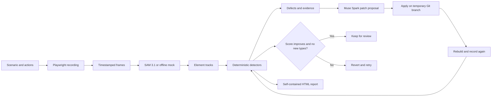

# JankHunter

**Find visual bugs in canvas interfaces by watching them over time.**

A canvas or WebGL game can look correct in a screenshot while a sprite jitters, a HUD jumps after a font loads, or an object blinks out for a few frames. JankHunter records a scripted browser session, tracks named visual elements, and checks their movement and visibility with deterministic detectors. It can then ask Meta Muse Spark for a small code change and rerun the same scenario to check whether the measured defects improved.

This project was built during the Meta Global AI Developer Hackathon 2026. It is an early prototype; see [Limits](#limits) before treating a result as proof of correctness.

## Run the demo

Use Python 3.11, Git, and Windows PowerShell. The commands below keep packages inside a local virtual environment. Playwright's browser is installed once on the machine.

```powershell
py -3.11 -m venv .venv
.venv\Scripts\python.exe -m pip install -r requirements.txt
.venv\Scripts\python.exe -m playwright install chromium
.venv\Scripts\python.exe -m http.server 8080 --directory demo/buggy
```

In a second terminal, from the repository root:

```powershell
.venv\Scripts\python.exe -m jankhunter.cli capture demo/scenario.json --out runs/capture
.venv\Scripts\python.exe -m jankhunter.cli detect demo/scenario.json --frames runs/capture --out runs/detect
```

The default tracker is `mock`. It reads the demo's `gt.json` sidecar, so it is useful for offline development and tests only. To use actual visual tracking, place your key in the ignored `.env` file (copy `.env.example` if needed), then run:

```powershell
.venv\Scripts\python.exe -m jankhunter.cli detect demo/scenario.json --frames runs/capture --tracker meta-sam --out runs/sam-detect
```

The example asks SAM 3.1 to track one concept, `cyan game sprite`. SAM accepts one noun phrase per request; add more phrases to `sam_prompts` only when you want the extra requests. The uploaded video is sampled to at most 120 frames and deleted after the request. SAM requires at least 50 video frames. See Meta's [SAM segmenting guide](https://dev.meta.ai/docs/sam/segmenting) and [Python parser guide](https://dev.meta.ai/docs/sam/client-libraries) for the request and response formats.

## Try the offline fix loop

This uses a deterministic fixture patch and mock tracks. It does not call Meta APIs:

```powershell
.venv\Scripts\python.exe -m jankhunter.cli fix demo/scenario.json --offline --out runs/offline-fix
```

`fix` writes an HTML report itself. To rebuild one from saved before/after runs:

```powershell
.venv\Scripts\python.exe -m jankhunter.cli report --before runs/offline-fix/before --after runs/offline-fix/after-try-1 --history runs/offline-fix/iterations.json --out runs/offline-fix/report.html
```

For a model-assisted fix, copy `.env.example` to `.env`, set `MODEL_API_KEY` there, and omit `--offline`. The default is one repair attempt to limit model calls; the loop tracks the sprite with SAM 3.1, sends defect measurements, up to two resized evidence frames, and the buggy demo source to Muse Spark, then tests its proposed patch on a temporary Git branch. The branch is kept only when the measured severity falls and no new defect type appears. Review accepted edits before committing them. The request uses Meta's [Messages API](https://dev.meta.ai/docs/protocols/messages).

## What the detectors measure

| Signal | Measurement |
| --- | --- |
| Jitter | High-frequency movement left after smoothing the centroid path |
| Layout jump | A large position change without a gradual velocity increase |
| Flicker | Repeated visibility changes in a short time window |
| Vanish | An element disappears and later returns near its earlier position |
| Stutter | Repeated frames or timestamp gaps while an element is moving |

The detectors are ordinary Python functions with fixed thresholds. They do not use an LLM to decide whether a defect exists. Scores are comparison signals for this scenario, not a universal visual-quality score.

## How it works



## Capture, reports, and tests

Capture prefers Chromium's CDP screencast and falls back to Playwright video. It is not a hard real-time recorder: expect about 10–24 frames per second depending on machine load. Below 15 fps, short glitches are easier to miss. The fallback reconstructs timestamps from the saved video and is less precise than CDP timestamps. The report command creates a self-contained HTML file with defect tables, trajectories, frame evidence, patch diff, and iteration history.

Run the unit suite and lint checks with:

```powershell
.venv\Scripts\python.exe -m pytest
.venv\Scripts\ruff.exe check .
```

The static vanilla-JavaScript demo is served with Python's built-in HTTP server. `demo/buggy` contains the planted source defects; `demo/fixed` is a reference and is not passed to the diagnoser. `MockTracker` reads test fixture ground truth. Never present mock-tracker results as black-box visual perception.

## Limits

- SAM returns boxes on sampled frames, not calibrated measurements. Small or visually ambiguous objects may be missed, merged, or assigned a different ID. Detector confidence depends on the tracking result and capture cadence.
- The sample scenario focuses on one sprite. Reliable tracking of several objects requires carefully chosen phrases and separate requests; the current prototype has not been validated across real games or browsers.
- Muse Spark proposes code edits. A falling detector score on one scripted run does not prove the patch is correct or safe. Inspect the diff and repeat with additional scenarios before shipping.
- The demo and tests establish a working research prototype, not production readiness or a guaranteed reduction in real-world incidents.

## Project files

- `jankhunter/` — capture, trackers, detectors, repair loop, report, and CLI.
- `demo/` — original canvas app, planted defects, clean reference, and scenario.
- `tests/` — synthetic detector, fix-loop, and SAM parsing/video tests.
- `docs/DEVLOG.md` — short build notes.

## License

MIT. See [LICENSE](LICENSE).
