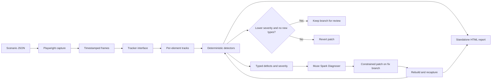

# JankHunter

**Temporal visual regression testing for canvas and game-style web interfaces.**

JankHunter records a scripted browser session, tracks prompted visual elements, detects motion and visibility defects with deterministic rules, then can ask Muse Spark to propose a small patch and verify it against a fresh recording. This targets bugs that a DOM snapshot misses: a sprite that jitters, a HUD that jumps after fonts load, or an element that disappears for a few frames.

> Built during the Meta Global AI Developer Hackathon 2026 (Indie track).

## Try it locally

Requires Python 3.11+, Git, and a Playwright Chromium install.

```powershell
python -m pip install -e ".[dev]"
python -m playwright install chromium
python -m http.server 8080 --directory demo/buggy
```

In a second terminal from the repository root:

```powershell
jankhunter capture demo/scenario.json --out runs/capture
jankhunter detect demo/scenario.json --frames runs/capture --out runs/detect
```

`MockTracker` reads the demo app's `gt.json` sidecar; it is a local development fixture, not visual perception. Use the included offline repair fixture to exercise the complete branch and verification flow without an API key:

```powershell
jankhunter fix demo/scenario.json --offline --out runs/fix
```

The scenario URL defaults to `http://localhost:8080`. Serve `demo/buggy` on that port for the planted bugs; to inspect the clean reference serve `demo/app` or `demo/fixed` instead.

## Muse Spark repair

Set `MODEL_API_KEY` in the environment, then run `jankhunter fix`. JankHunter sends detected defect measurements and the buggy demo source to Muse Spark through the Meta Model API Messages endpoint. The model returns exact-text edit blocks; JankHunter constrains file paths to the repository, requires a unique match, applies the patch on a `jankhunter/fix-*` branch, and accepts only a lower severity score with no new defect type. Rejected work is reverted. Review any accepted branch before committing it.

```powershell
$env:MODEL_API_KEY = "<your Meta Model API key>"
jankhunter fix demo/scenario.json --out runs/fix
```

The API key is read from the environment and must never be committed. Configure access and billing through [Meta Model API](https://dev.meta.ai/). The implementation uses the documented `https://api.meta.ai/v1/messages` endpoint and Muse Spark 1.3; see [Messages API](https://dev.meta.ai/docs/protocols/messages) and [Muse Spark developer guide](https://dev.meta.ai/resources/blog/build-with-muse-spark).

## Architecture



## Detection signals

- **Jitter:** high-frequency centroid residual after Savitzky–Golay smoothing.
- **Layout jump:** unusually large displacement without a preceding velocity ramp.
- **Flicker:** repeated visibility changes in a sliding window.
- **Vanish:** an object disappears and returns near its previous position.
- **Stutter:** a timestamp gap or repeated frame image while a tracked object is moving.

Each detector is deterministic and has synthetic positive and clean-track tests. Severity is a scenario-level heuristic for comparing before and after runs, not a universal UX score.

## Capture and tracker status

Capture prefers Chromium CDP `Page.startScreencast`; Playwright video is recorded as a fallback and requires `ffmpeg`/`ffprobe` to extract frames. Browser load and headless throttling affect frame cadence: this is not a hard-real-time recorder. Expect roughly 10–24 fps depending on the machine. Below 15 fps, brief jitter and duplicate-frame signals become less reliable; the fallback reconstructs timestamps from video frame rate and is less precise than CDP timestamps.

The `Tracker` interface is ready. `MockTracker` reconstructs tracks from the demo sidecar and is clearly restricted to local development and tests. `MetaSAMTracker` remains an honest Phase 2 stub: the SAM video-tracking endpoint and response schema have not been confirmed, so the project does not invent an integration or claim that the final pipeline uses SAM. Consequently, real-app perception is not implemented yet.

## Development

```powershell
pytest
ruff check .
```

The static demo is original vanilla JavaScript and runs with Python's built-in HTTP server. `demo/buggy` contains planted examples; `demo/fixed` is the clean reference and is not supplied to the diagnoser.

## Built during the hackathon

- Pydantic models and JSON scenario format.
- Playwright capture with CDP screencast and video fallback.
- Tracker abstraction, sidecar-backed mock, and SAM placeholder.
- Five deterministic temporal detectors and synthetic tests.
- Offline test diagnoser and Muse Spark Diagnoser through Meta Model API.
- Constrained patch application, branch-based verification, and standalone HTML report.
- Typer CLI for `capture`, `detect`, `fix`, and `report`.

## License

MIT. See [LICENSE](LICENSE).
